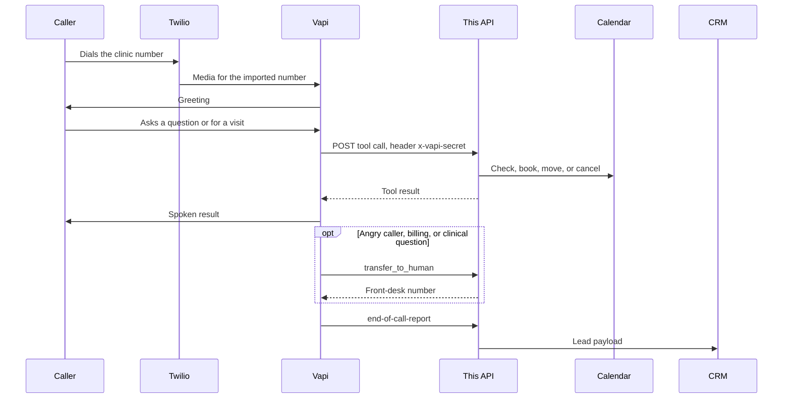
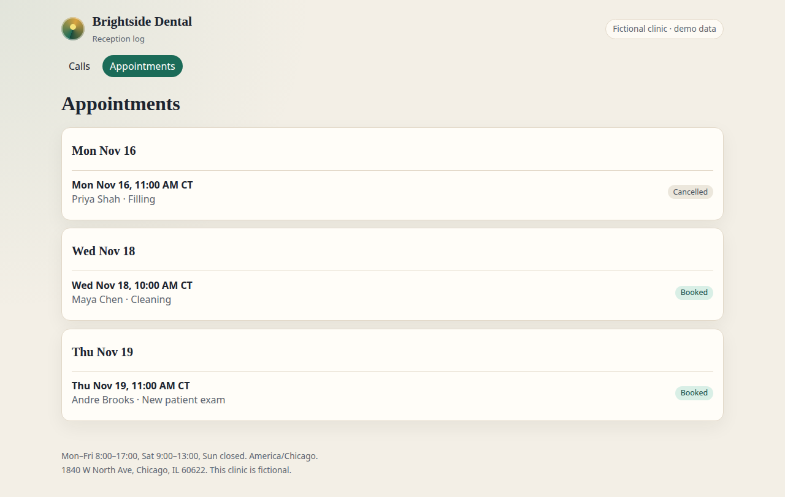

# voice-ai-receptionist

[](https://github.com/mustafaautomation/voice-ai-receptionist/actions/workflows/ci.yml)

Demo of an AI phone receptionist for **Brightside Dental**, a fictional clinic. Nothing in this repo is a real business, patient, or phone number. The `555` numbers and the Chicago address are fake.

A caller reaches a [Vapi](https://vapi.ai) assistant. Twilio supplies the phone number; Vapi connects that number to the assistant. This service is the tool backend: it checks the calendar, books, reschedules, cancels, transfers to a person, and on hang-up stores the transcript and pushes a lead to a CRM adapter.

Author: Muhammad Mustafa.

## Live demo

**https://voice.quvantic.com** — press "Talk to the receptionist" and speak to it in the browser (microphone needed).

- It is a portfolio demo, not a product. The clinic, address, and numbers are made up; please use a made-up name and a `555` number.
- The browser call goes to the same Vapi assistant and the same tool API described below. Bookings are real rows in the demo calendar and show up at [/appointments](https://voice.quvantic.com/appointments).
- It runs on free Vapi credits. Calls are capped at 4 minutes, and the button stops working once the credits run out. See [Call limits](#call-limits) for how the credits are protected.
- There is no phone number attached to the live demo. `transfer_to_human` returns the fictional front-desk number; on a web call nothing is actually dialled.
- The call log at [/calls](https://voice.quvantic.com/calls) starts with seeded sample calls. It lives in SQLite under `/tmp` on the serverless instance, so it resets when the instance is recycled and a call can be missing if its requests landed on different instances. Appointments do not have this problem (see below).

### How the live deploy is wired

| Piece | Where |
| --- | --- |
| Landing page and dashboard | Vercel. `public/` is served as static files; `api/index.js` runs the same Fastify app as `npm run dev`. |
| Voice (speech-to-text, `gpt-4o-mini`, text-to-speech) | Vapi, started from the page with `@vapi-ai/web` and the public key. |
| Tool calls and end-of-call report | Vapi posts to `https://voice.quvantic.com/vapi/tools/<name>` and `/vapi/webhook` with an `x-vapi-secret` header. |
| Appointments | `CALENDAR_PROVIDER=relay`: a JSON document store on Cloudflare D1, behind a Worker. |
| Call limits | `POST /api/call-token` checks the limits before the browser can start a call. Counters live in the same D1 store. |

The relay calendar loads the clinic's appointments, runs the same rules as the SQLite calendar, then writes through the store's atomic `reserve` call keyed on the slot start. A second booking for the same slot gets `409` and the caller hears that the time is taken, even when the two requests run on different serverless instances. If the store cannot be reached, the tool returns a spoken fallback instead of an error. Demo rows are deleted after 30 days.

### Call limits

The page has no Vapi key in its HTML. Before each call it asks `POST /api/call-token`, which:

1. Works out the visitor IP from the header Vercel sets (`TRUST_PROXY_HEADERS=true`; elsewhere it uses the socket address, so a spoofed header does not help). Only an HMAC of the IP is stored.
2. Allows **3 calls per visitor IP in a rolling 24 hours** and **40 calls per UTC day in total** (`WEB_CALL_LIMIT_PER_VISITOR`, `WEB_CALL_LIMIT_PER_DAY`). Each call is a numbered row in the D1 store written with the atomic `reserve`, so the counts hold across serverless instances and two racing requests cannot both take the last slot. If the store is unreachable, the call is refused.
3. Returns what the browser needs to start the call. There are two modes:
   - **`jwt` (preferred).** With `VAPI_API_KEY` and `VAPI_ORG_ID` set on the server, it signs a Vapi public JWT (HS256, server side). The token expires after 30 seconds and Vapi only accepts it from the allowed origin and for this one assistant. The public key can then be disabled in Vapi.
   - **`public-key` (fallback).** Without the private key on the server, it returns the Vapi public key, but only after the limit check. The key is restricted in Vapi to `https://voice.quvantic.com` and this assistant.

Over the limit, the endpoint returns `429` with a message the page shows ("You have used the 3 demo calls…" or "The demo has reached its call limit for today…").

**Current state of the live site:** it runs in `public-key` mode until the private key is added to the Vercel project. In that mode the limit is not airtight: someone who copies the public key from a granted response can start calls from a script that fakes the `Origin` header. In `jwt` mode the remaining gaps are smaller: rotating IP addresses gives 3 calls per address, still bounded by the 40-per-day cap, and one granted token can be replayed from a script until it expires 30 seconds later. Every call is capped at 4 minutes, and the Vapi account only holds free credits.

## Call flow



## Sample transcript

This is seeded demo data, not a recording.

> **Receptionist:** Thank you for calling Brightside Dental. I can share our hours, or book, move, and cancel a visit. What do you need?
>
> **Caller:** Hi, this is Maya Chen. I would like a cleaning. My number is 312-555-0121.
>
> **Receptionist:** The next opening I have is Wed Nov 18, 10:00 AM CT. Should I book that?
>
> **Caller:** Yes, please.
>
> **Receptionist:** You are booked for a cleaning on Wed Nov 18, 10:00 AM CT. We will see you then.

The matching call in the dashboard shows `check_availability`, then `book_appointment`, outcome **Booked**.

## Dashboard

`npm run dev` serves a small call log. It lists calls, opens a call with the transcript, tool calls, and outcome, and lists appointments.




## What the API does

| Method and path | Purpose |
| --- | --- |
| `POST /vapi/webhook` | Vapi server URL. Handles `tool-calls` and `end-of-call-report`. |
| `POST /vapi/tools/check_availability` | Open slots. |
| `POST /vapi/tools/book_appointment` | Book a slot. |
| `POST /vapi/tools/reschedule_appointment` | Move a visit. |
| `POST /vapi/tools/cancel_appointment` | Cancel a visit. |
| `POST /vapi/tools/transfer_to_human` | Return the front-desk number. |
| `GET /calls`, `GET /calls/:id`, `GET /appointments` | Dashboard. |
| `GET /health` | Health check. |

Every Vapi request must send `x-vapi-secret`. Payloads are checked with Zod. A repeated tool call with the same call id and tool-call id returns the stored result and does not book twice. A repeated end-of-call report for the same call id does not push the lead twice. If the CRM push fails, the handler returns 502 and keeps the key open so a retry can push once.

Business rules, America/Chicago:

- Monday–Friday 8:00–17:00, Saturday 9:00–13:00, Sunday closed.
- 30 minute slots, aligned to the opening time.
- A booked start time is unique. SQLite enforces that with a partial unique index inside a transaction.
- Cancel and reschedule need 24 hours notice.
- Times in the past, outside those hours, or more than 60 days ahead are rejected.
- The tool result explains the refusal so the assistant can say it.

## Calendar and CRM

`CALENDAR_PROVIDER=sqlite` is the default. `relay` is what the live demo uses: it needs `RELAY_URL` and `RELAY_TOKEN` for a document store with list, put, and atomic reserve routes (see `src/calendar/relay.ts`), and tags rows with `RELAY_NAMESPACE`. The database is a local file (`data/clinic.sqlite`) seeded with fake calls when empty. `memory` uses the same rules with no file. `calcom` calls the Cal.com API v2 and is off unless `CALCOM_API_KEY` and `CALCOM_EVENT_TYPE_ID` are set. Hours and the cancellation window are still checked locally before that HTTP call.

`CRM_PROVIDER=memory` stores the push result on the call. `webhook` POSTs JSON to `CRM_WEBHOOK_URL`. `ghl-stub` only builds a contact-shaped payload and returns a fake id. It does not call GoHighLevel. See `src/crm/ghl-stub.ts`.

## Setup

Requires Node.js 22.

```bash
cp .env.example .env
# Set VAPI_WEBHOOK_SECRET to any long random string. Leave VAPI_API_KEY empty for a dry run.
npm install
npm run dev
```

Open http://localhost:3000 for the landing page or http://localhost:3000/calls for the call log. The seed runs when the calls table is empty. To place a call from the landing page, set `VAPI_ASSISTANT_ID` and either `VAPI_API_KEY` with `VAPI_ORG_ID`, or `VAPI_PUBLIC_KEY`; without a relay store the limits are kept in memory.

Docker Compose uses the same `.env` file:

```bash
docker compose up --build
```

### Sync the Vapi assistant

Assistant name, system prompt, voice, and tool definitions live in `src/vapi/assistant.ts`.

```bash
npm run vapi:sync
```

With no `VAPI_API_KEY`, that prints the payload and does not call Vapi. With a key, it creates or updates the assistant named `Brightside Dental Receptionist`. Set `PUBLIC_BASE_URL` to a URL Vapi can reach (a tunnel or a host) before syncing, because tool URLs are built from it. The payload sends `VAPI_WEBHOOK_SECRET` as an `x-vapi-secret` header on the server URL and on every tool, so nothing needs to be copied by hand. Calls are capped at 240 seconds.

### Deploy to Vercel

`vercel.json` builds with `npm run build`, serves `public/`, and sends every other path to `api/index.js`. Set these project environment variables: `VAPI_API_KEY` (private key, used to sign call tokens; or `VAPI_PUBLIC_KEY` for the fallback mode), `VAPI_ORG_ID`, `VAPI_ASSISTANT_ID`, `TRUST_PROXY_HEADERS=true`, `VAPI_WEBHOOK_SECRET`, `CALENDAR_PROVIDER=relay`, `RELAY_URL`, `RELAY_TOKEN`, `DATABASE_PATH=/tmp/clinic.sqlite`, `SERVE_STATIC=false`, and `PUBLIC_BASE_URL`. Then run `vercel deploy --prod` and `npm run vapi:sync` with the same `PUBLIC_BASE_URL`.

### Connect a Twilio number

In the Vapi dashboard, import a Twilio number (Account SID and Auth Token) and assign **Brightside Dental Receptionist**. Vapi places the call audio; this service only receives tool calls and the end-of-call report. A local process is not reachable from Vapi until `PUBLIC_BASE_URL` is a public URL.

## Evals

Conversation evals replay a transcript against the real tool handlers and an in-memory calendar. The default model is scripted, so CI does not need an API key. They assert the tool names and the outcome (booked, slot taken, outside hours, rescheduled, cancelled, transferred, or no booking). They do not grade the wording.

```bash
npm run eval
```

`npm test` runs the same scenarios. Optional live mode sends the same transcripts to OpenAI and still checks tools and outcomes. It is not part of CI and can fail when the model picks a different slot.

```bash
EVAL_MODE=live OPENAI_API_KEY=... npm run eval:live
```

Scenarios: happy-path booking, double booking, after-hours, reschedule, cancel, angry caller to transfer, wrong number, FAQ.

## Tests and CI

```bash
npm run lint
npm run typecheck
npm run test:coverage
npm run test:e2e
```

GitHub Actions runs those four commands on pull requests and on `main`. Jobs do not use `continue-on-error`. Playwright covers the calls list, a call detail page, search, a missing call, and the appointments page, and writes the screenshots above.

Coverage thresholds in `vitest.config.ts` are 80% statements, 80% lines, 80% functions, and 70% branches, measured on `src/`.
