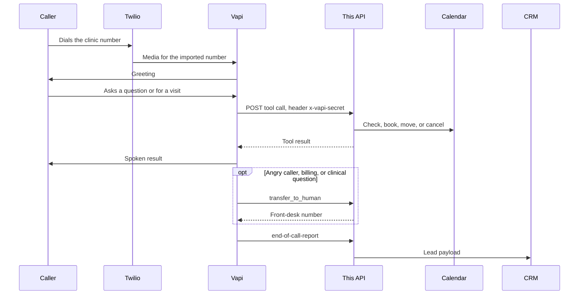
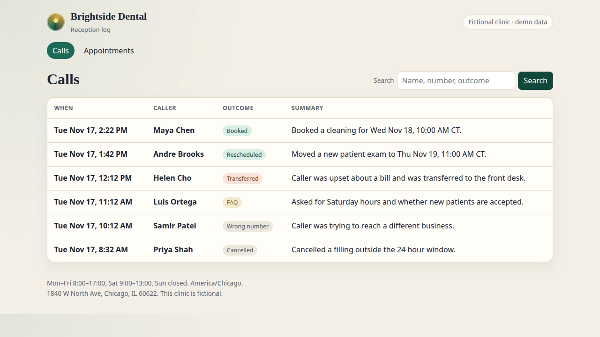
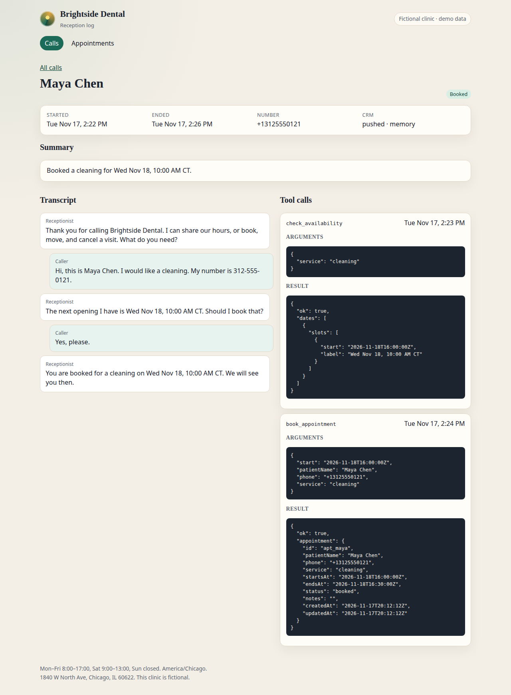

# voice-ai-receptionist

[](https://github.com/mustafaautomation/voice-ai-receptionist/actions/workflows/ci.yml)

Demo of an AI phone receptionist for **Brightside Dental**, a fictional clinic. Nothing in this repo is a real business, patient, or phone number. The `555` numbers and the Chicago address are fake.

A caller reaches a [Vapi](https://vapi.ai) assistant. Twilio supplies the phone number; Vapi connects that number to the assistant. This service is the tool backend: it checks the calendar, books, reschedules, cancels, transfers to a person, and on hang-up stores the transcript and pushes a lead to a CRM adapter.

Author: Muhammad Mustafa.

## Call flow



## Sample transcript

This is seeded demo data, not a recording.

> **Receptionist:** Thank you for calling Brightside Dental. I can share our hours, or book, move, and cancel a visit. What do you need?
>
> **Caller:** Hi, this is Maya Chen. I would like a cleaning. My number is 312-555-0121.
>
> **Receptionist:** The next opening I have is Wed Nov 18, 10:00 AM CT. Should I book that?
>
> **Caller:** Yes, please.
>
> **Receptionist:** You are booked for a cleaning on Wed Nov 18, 10:00 AM CT. We will see you then.

The matching call in the dashboard shows `check_availability`, then `book_appointment`, outcome **Booked**.

## Dashboard

`npm run dev` serves a small call log. It lists calls, opens a call with the transcript, tool calls, and outcome, and lists appointments.






## What the API does

| Method and path | Purpose |
| --- | --- |
| `POST /vapi/webhook` | Vapi server URL. Handles `tool-calls` and `end-of-call-report`. |
| `POST /vapi/tools/check_availability` | Open slots. |
| `POST /vapi/tools/book_appointment` | Book a slot. |
| `POST /vapi/tools/reschedule_appointment` | Move a visit. |
| `POST /vapi/tools/cancel_appointment` | Cancel a visit. |
| `POST /vapi/tools/transfer_to_human` | Return the front-desk number. |
| `GET /calls`, `GET /calls/:id`, `GET /appointments` | Dashboard. |
| `GET /health` | Health check. |

Every Vapi request must send `x-vapi-secret`. Payloads are checked with Zod. A repeated tool call with the same call id and tool-call id returns the stored result and does not book twice. A repeated end-of-call report for the same call id does not push the lead twice. If the CRM push fails, the handler returns 502 and keeps the key open so a retry can push once.

Business rules, America/Chicago:

- Monday–Friday 8:00–17:00, Saturday 9:00–13:00, Sunday closed.
- 30 minute slots, aligned to the opening time.
- A booked start time is unique. SQLite enforces that with a partial unique index inside a transaction.
- Cancel and reschedule need 24 hours notice.
- Times in the past, outside those hours, or more than 60 days ahead are rejected.
- The tool result explains the refusal so the assistant can say it.

## Calendar and CRM

`CALENDAR_PROVIDER=sqlite` is the default. The database is a local file (`data/clinic.sqlite`) seeded with fake calls when empty. `memory` uses the same rules with no file. `calcom` calls the Cal.com API v2 and is off unless `CALCOM_API_KEY` and `CALCOM_EVENT_TYPE_ID` are set. Hours and the cancellation window are still checked locally before that HTTP call.

`CRM_PROVIDER=memory` stores the push result on the call. `webhook` POSTs JSON to `CRM_WEBHOOK_URL`. `ghl-stub` only builds a contact-shaped payload and returns a fake id. It does not call GoHighLevel. See `src/crm/ghl-stub.ts`.

## Setup

Requires Node.js 22.

```bash
cp .env.example .env
# Set VAPI_WEBHOOK_SECRET to any long random string. Leave VAPI_API_KEY empty for a dry run.
npm install
npm run dev
```

Open http://localhost:3000/calls . The seed runs when the calls table is empty.

Docker Compose uses the same `.env` file:

```bash
docker compose up --build
```

### Sync the Vapi assistant

Assistant name, system prompt, voice, and tool definitions live in `src/vapi/assistant.ts`.

```bash
npm run vapi:sync
```

With no `VAPI_API_KEY`, that prints the payload and does not call Vapi. With a key, it creates or updates the assistant named `Brightside Dental Receptionist`. Set `PUBLIC_BASE_URL` to a URL Vapi can reach (a tunnel or a host) before syncing, because tool URLs are built from it. Put the same value in the Vapi server URL secret as `VAPI_WEBHOOK_SECRET`.

### Connect a Twilio number

In the Vapi dashboard, import a Twilio number (Account SID and Auth Token) and assign **Brightside Dental Receptionist**. Vapi places the call audio; this service only receives tool calls and the end-of-call report. A local process is not reachable from Vapi until `PUBLIC_BASE_URL` is a public URL.

## Evals

Conversation evals replay a transcript against the real tool handlers and an in-memory calendar. The default model is scripted, so CI does not need an API key. They assert the tool names and the outcome (booked, slot taken, outside hours, rescheduled, cancelled, transferred, or no booking). They do not grade the wording.

```bash
npm run eval
```

`npm test` runs the same scenarios. Optional live mode sends the same transcripts to OpenAI and still checks tools and outcomes. It is not part of CI and can fail when the model picks a different slot.

```bash
EVAL_MODE=live OPENAI_API_KEY=... npm run eval:live
```

Scenarios: happy-path booking, double booking, after-hours, reschedule, cancel, angry caller to transfer, wrong number, FAQ.

## Tests and CI

```bash
npm run lint
npm run typecheck
npm run test:coverage
npm run test:e2e
```

GitHub Actions runs those four commands on pull requests and on `main`. Jobs do not use `continue-on-error`. Playwright covers the calls list, a call detail page, search, a missing call, and the appointments page, and writes the screenshots above.

Coverage thresholds in `vitest.config.ts` are 80% statements, 80% lines, 80% functions, and 70% branches, measured on `src/`.
